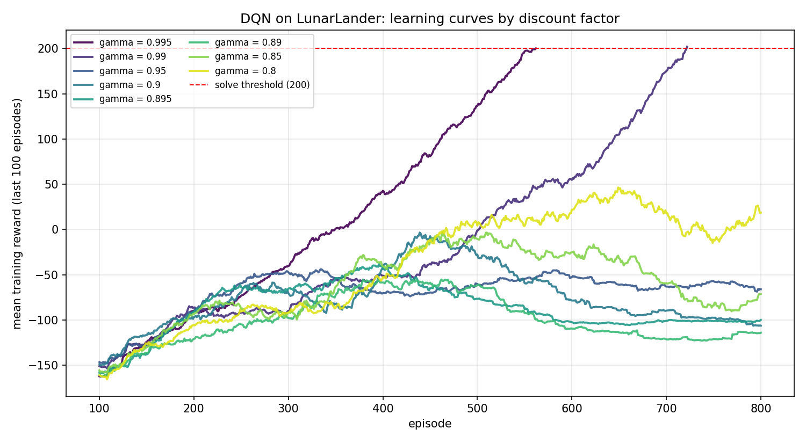
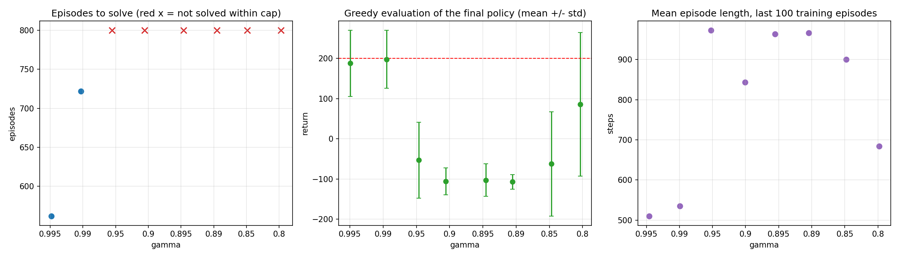

# DQN on LunarLander: effect of the discount factor (gamma)

An independent DQN implementation (TensorFlow/Keras) used to study how the discount factor `gamma`
affects learning speed, stability and final landing quality on Gymnasium's `LunarLander`.

**Experiment 1:** `gamma` in `{0.995, 0.99, 0.95, 0.9, 0.895, 0.89, 0.85, 0.8}`, all other settings fixed, one seed, 800-episode cap per run.

## Results




| gamma | horizon 1/(1-g) | solved | episodes to solve | train avg, last 100 | greedy eval (mean ± std, 20 ep.) | eval success rate | mean episode length, last 100 |
|---|---|---|---|---|---|---|---|
| 0.995 | 200 | yes | 562 | 200.1 | 187.8 ± 82.4 | 55% | 510 |
| 0.99 | 100 | yes | 722 | 201.9 | 197.7 ± 72.1 | 50% | 535 |
| 0.95 | 20 | no | - | -66.0 | -53.0 ± 94.2 | 5% | 973 |
| 0.90 | 10 | no | - | -106.2 | -106.0 ± 33.4 | 0% | 844 |
| 0.895 | 9.5 | no | - | -99.8 | -102.7 ± 40.4 | 0% | 964 |
| 0.89 | 9.1 | no | - | -114.0 | -107.0 ± 17.8 | 0% | 966 |
| 0.85 | 6.7 | no | - | -71.2 | -62.1 ± 129.8 | 15% | 901 |
| 0.80 | 5.0 | no | - | 18.7 | 86.2 ± 178.6 | 55% | 684 |

"Solved" means a mean training reward of at least 200 over 100 episodes. "Eval success rate" is the share of 20 greedy
evaluation episodes with return >= 200 (standard error about 11 percentage points).

### Key findings

- `gamma >= 0.99` solved the task (562 and 722 episodes); every value from 0.95 down did not within 800 episodes. The threshold lies somewhere between 0.95 and 0.99 and was not located.
- **Every unsolved run rose and then declined.** Peaks of the 100-episode average were reached around episodes 350 to 650 (for example 0.895: about -9 at episode 400, ending near -110).
- For `gamma` of 0.95 to 0.85 the final episodes last 900 to 970 steps, close to the 1000-step limit, against about 510 to 535 for the solved runs. This is consistent with the agent staying airborne instead of landing, but it was not verified with per-episode diagnostics.
- Below the threshold there is no monotonic trend: `gamma = 0.8` finished best of the unsolved runs (greedy mean 86, but with a std of 179 and a training curve that swings by about 55 points). With one seed this may be noise.
- Plausible causes, none tested yet: effective horizon much shorter than the roughly 500-step flight, the environment's shaping reward not being consistent with `gamma < 1`, replay-buffer flooding by long episodes, epsilon decay unmasking the greedy policy, and generic DQN instability. See the notebook for details and the planned follow-up experiments.

## Method

- Network: 8 -> 64 -> 64 -> 4, ReLU hidden layers, linear output.
- Online + target network with soft updates (`tau = 1e-3`), Adam (`lr = 1e-3`), uniform replay buffer (100k), batch size 64, one update every 4 environment steps.
- Epsilon-greedy exploration, decayed per episode (`1.0 -> 0.01`, factor `0.995`).
- Solve criterion: mean training reward >= 200 over 100 episodes, with an 800-episode cap per run.
- After training, the final policy is evaluated greedily for 20 episodes.
- Time-limit truncation is treated as non-terminal (the Bellman target still bootstraps).

## Running

**Google Colab (recommended):** [](https://colab.research.google.com/github/mjsafy/dqn-lunarlander-experiments/blob/main/notebooks/01_gamma_sweep.ipynb)
Use a CPU runtime and run all cells. Results are written to Google Drive (`MyDrive/dqn_lunar/01_gamma_sweep/`) after every finished run, ...
A resumable checkpoint (networks, replay buffer, history) is also written every 25 episodes, so an interrupted run continues from its last checkpoint instead of restarting.
The full sweep above took about 76 minutes on a 2-core Colab CPU.

**Local:**
```bash
pip install "gymnasium[box2d]" tensorflow tf_keras numpy pandas matplotlib
jupyter notebook notebooks/01_gamma_sweep.ipynb
```
(Box2D may need `swig`; on Windows, WSL2 is usually the easiest route.)

## Limitations

- One seed per `gamma`, so differences between neighbouring values are not meaningful and no statistical claims are made.
- Only `gamma` is varied; other hyperparameters were not re-tuned per `gamma`.
- Unsolved runs stopped at 800 episodes; some might solve the task with a larger budget.
- Runs stop when the criterion is met, so a possible later collapse of the solved runs is not observed.
- Episodes-to-solve depends on the per-episode epsilon schedule as well as on `gamma`.
- 20 evaluation episodes give a coarse success rate.

## Planned follow-ups

Per-episode diagnostics (termination reason, action frequencies, periodic greedy evaluation), continuing training past the solve point,
`gamma`-consistent reward shaping, a larger replay buffer, multiple seeds and finer `gamma` values between 0.95 and 0.99.

## References

- Mnih et al., *Human-level control through deep reinforcement learning*, Nature 518, 529-533 (2015).
- Gymnasium LunarLander documentation.

This project is my own implementation. It was motivated by a Coursera/DeepLearning.AI assignment, but it contains no course material.
