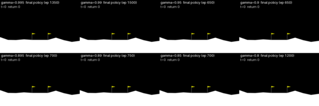

# 03: What actually goes wrong at low discount factors?

NumPy DQN (same architecture and hyper-parameters as experiment 01), 3 seeds, adaptive stopping (a run stops when its training return has stopped improving beyond noise; 22 of 24 baseline runs stopped this way), greedy evaluation every 50 episodes and 100 greedy episodes at the end, and four single-change intervention arms.
Full method, pre-registered hypotheses, decision rules and every output: [the notebook](../../notebooks/03_diagnostics.ipynb). The numbers below are copied from its outputs; "measured" means taken from a table or figure, "reasoning" means an explanation.

## Videos

Final greedy policy of every baseline gamma (seed 0, same initial condition). Full quality: [overview_final_policies.mp4](videos/overview_final_policies.mp4); more in [videos/](videos/).

These are illustrations of single runs, selected by a rule fixed in advance (seed 0, first held-out initial condition), not evidence.

## Main findings

- **Validation (measured).** At gamma 0.95 and 0.9 the TensorFlow run of experiment 01 fell inside the NumPy seed range (plus pre-set margins) for all three compared metrics. Only one TensorFlow run per gamma exists, so this shows no evidence of a difference, not equivalence.
- **H1, replicated (measured).** gamma 0.995 and 0.99 solved the task in 3/3 seeds (median 660 and 571 episodes); all six lower values solved in 0/3 seeds, including 0.8.
- **H2, failing runs hover (measured).** For gamma 0.95, 0.895, 0.89 and 0.85, 3/3 seeds ended at least half of the final greedy episodes at the 1000-step limit (0.9: 2/3; the third seed ended 80% out of bounds). Time-limit endings were airborne in 99-100% of cases. These runs fly high (mean altitude 0.75-1.33 in observation units, solved runs 0.42-0.50) with the main engine on 55-57% of steps (solved runs 30-44%), and land in at most 5% of episodes.
- **The "rise then fall" is mostly a training-return effect (measured, with a caveat).** The greedy policy's decline after the training-return peak was not detected: mean +8.9 return points (95% CI -4.1 to +23.3, 18 runs, Holm p = 0.75, typical seed spread 16.9). The gap between training return and greedy return was 43.4 at the peak and 5.6 at the end (mean over unsolved runs), consistent with exploration noise helping early and vanishing later. The gap at the peak is biased upward because the peak is chosen on the training curve. Exploratory (not tested): only gamma 0.85 had a positive decline in all 3 seeds (+23, +71, +81).
- **Solved runs did not collapse (measured).** After solving, the greedy return kept rising (mean change -34 return points, CI -67 to -9, 6 runs); final greedy returns were 237-267 with about 90% successful landings.
- **Cheap fixes did not work (measured, 9 paired runs at gamma 0.95, 0.9, 0.8).** Replay buffer of 1,000,000: -2.7 (CI -33 to +28). Time limit as terminal: time-limit share +0.05 (CI -0.09 to +0.22). Huber loss: -1.2 (CI -22 to +16). None is distinguishable from zero. A 1M buffer or Huber loss lowered the greedy return at the gamma 0.99 control (-65 and -42, 3/3 pairs).
- **The gamma-consistent shaping correction made things worse (measured).** -222 return points (CI -354 to -102) at the three failing gammas and -40 at the 0.99 control (3/3 pairs). The pre-registered test asked for an improvement; the harm is an exploratory reading of the interval. Reasoning, untested: the correction adds `(1-gamma)*|Phi(s')|` to every non-terminal step, which can be of order 10 per step at gamma 0.9 and forces the value function to represent large state-dependent offsets.
- **Value estimates carry no landing signal in failing runs (measured, interpretation is reasoning).** At the end of failing runs the replay buffer contains almost no terminal transitions (fraction at most 0.001; 0.003-0.004 in solved runs) and the mean maximum Q is between -0.6 and +1.0 (41-78 in solved runs). With a typical landing of 222 steps, `gamma^222` is 1.1e-5 at 0.95 and 7e-11 at 0.9 (0.33 at 0.995, 0.11 at 0.99), so the +100 is invisible from the start of a flight at low gamma.
- **gamma 0.8 is not like its neighbours (measured).** Final greedy return +29 to +51, 41-55% landed, 17-36% crashed; experiment 01's single-seed observation that 0.8 is the best unsolved value is reproduced. No explanation has been tested.

## What remains open

The short-horizon explanation (H10) is consistent with every measurement but was not tested directly: no arm changed the effective horizon without changing gamma. A "by elimination" argument is weak here because each arm is one implementation tested on 3 seeds. See Section 11 of the notebook for the next experiments.

## Files

- `hypothesis_tests.csv`: test family with Holm-adjusted p-values and verdicts; `summary_per_run.csv`, `summary_by_gamma.csv`, `decline_per_run.csv`, `buffer_and_q_descriptives.csv`, `horizon_vs_flight.csv`, `validation_numpy_vs_tf.csv`, `env_info.json`
- `figures/`: learning curves with greedy evaluation, outcomes by gamma, train-vs-greedy gap, and (if present) arm comparison and post-solve curves
- `runs/`: one small `.npz` per finished run (`<arm>__gamma<g>_seed<s>.npz`); network weight snapshots stay on Drive
- `videos/`: greedy rollouts of saved policies (if present)
